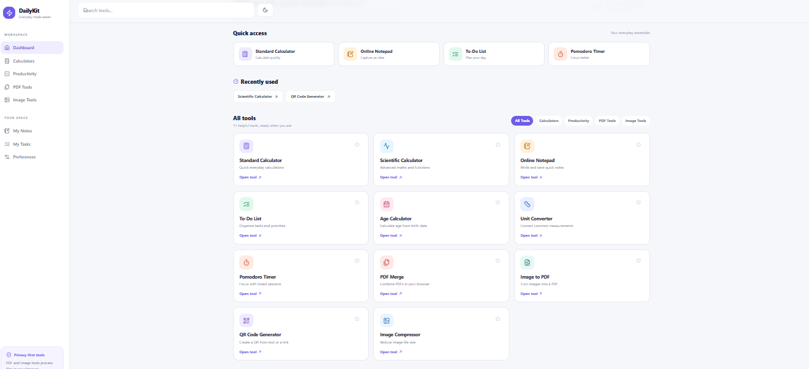

# DailyKit — All-in-One Daily Utility Website

A modern, responsive utility dashboard built with Next.js that brings 11 useful everyday tools together in one place.

## Preview



## About the Project

DailyKit is an all-in-one web application designed to make everyday tasks easier through a clean interface and simple, accessible tools.

## Features

1. **Standard Calculator** — Perform basic mathematical calculations.
2. **Scientific Calculator** — Perform advanced mathematical calculations.
3. **Online Notepad** — Write and manage notes.
4. **To-Do List** — Organize tasks and track your work.
5. **Age Calculator** — Calculate age from a date of birth.
6. **Unit Converter** — Convert supported units.
7. **Pomodoro Timer** — Manage focused work sessions and breaks.
8. **PDF Merge** — Combine PDF files.
9. **Image to PDF** — Convert images into a PDF.
10. **QR Code Generator** — Generate QR codes.
11. **Image Compressor** — Reduce image file sizes.

## Tech Stack

- Next.js
- React
- JavaScript
- Tailwind CSS
- MongoDB Atlas (optional, for cloud-based notes and tasks)

## Requirements

- Node.js 18.18 or later
- Node.js 20 LTS recommended
- MongoDB Atlas account (optional; required for cloud-based note and task saving)

## Run Locally

### 1. Download the Project

Download or clone this repository and open the `dailykit` folder in your terminal.

### 2. Install Dependencies

```bash
npm install
```

### 3. Configure Environment Variables

Copy `.env.example` to `.env.local`.

Add your MongoDB connection string to `MONGODB_URI` and set `MONGODB_DB=dailykit` if you want cloud-based note and task saving.

If you do not configure MongoDB, the website and its browser-local fallback can still work.

### 4. Configure MongoDB Atlas (Optional)

If using MongoDB Atlas:

- Create a database user with a strong password.
- Configure Network Access to allow your computer to connect.
- Add the connection string to `.env.local`.
- URL-encode special characters in the password when required.

Never publish your database credentials.

### 5. Start the Development Server

```bash
npm run dev
```

### 6. Open the Website

Visit [http://localhost:3000](http://localhost:3000).

## Data and Privacy Notes

- Notes and tasks can use MongoDB-backed API routes when configured.
- Browser-local fallback storage is available when MongoDB is not configured.
- Browser-local data is generally limited to the same browser and device.
- The current browser-generated client ID approach is not authentication or access control.
- Do not use this setup for private multi-user production data without proper authentication and server-side authorization.
- PDF and image processing tools are designed to process files in the browser rather than intentionally upload them to the application server.

## Project Structure

```text
dailykit/
├── app/
├── components/
├── lib/
├── public/
├── screenshots/
│   └── dashboard.png
├── package.json
├── README.md
└── .env.example
```

The actual project structure may contain additional files and folders.

## Security Considerations

Before deploying for public production use, consider adding:

- Authentication and authorization
- Server-side access controls
- Rate limiting and request size limits
- Monitoring and automated tests
- A privacy policy

Never commit `.env.local`, passwords, API secrets, or database credentials to GitHub.

## Deployment

This project can be deployed to a compatible hosting platform such as Vercel.

If MongoDB is not required, make sure the application uses the browser-local fallback correctly before deployment.

**Live Demo:** Add your deployed website URL here after deployment.

## Author

Developed as a personal web development project.
